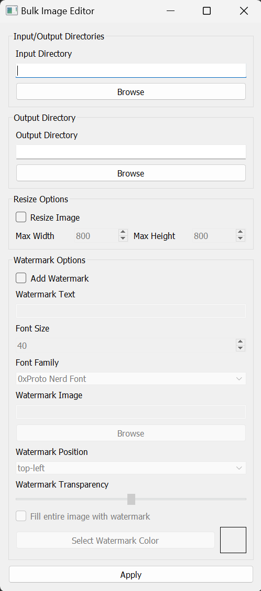
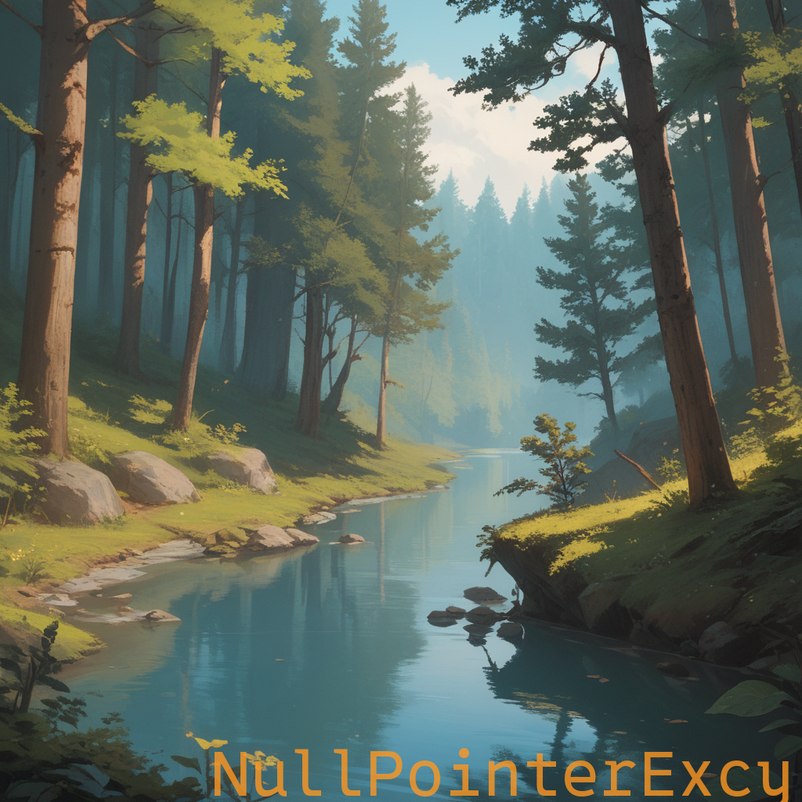
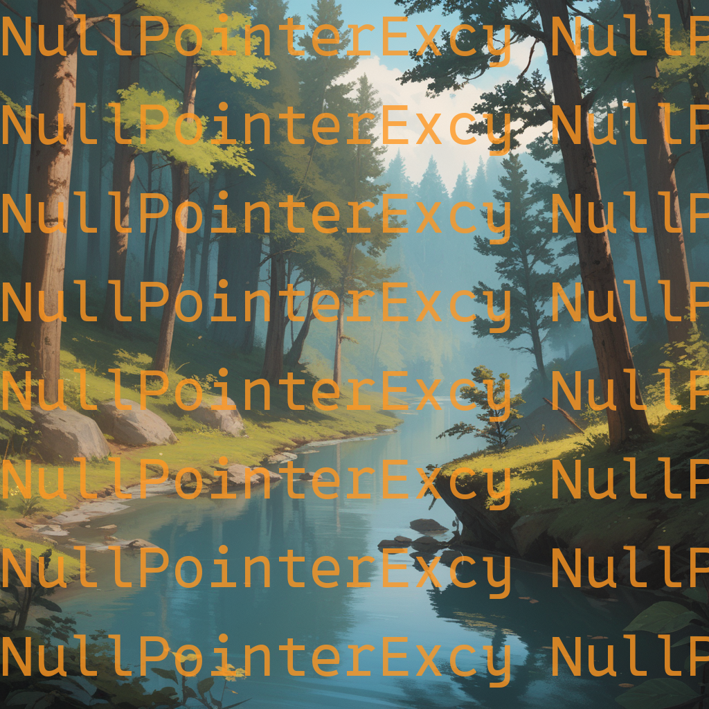

# BulkImageEditor

[](https://github.com/NullPointerExcy/BulkImageEditor/releases/latest)


A simple image processing tool for resizing images and adding text watermarks to them. Built using Python's `Pillow`
library, this tool can adjust image dimensions while maintaining aspect ratio and apply customizable text or image watermarks.

### UI Preview

<div align="center">
  
</div>

## Features

- **Resize Options**: Easily resize images to fit custom dimensions while maintaining aspect ratios.
- **Watermarking**:
  - **Text Watermarking**: Apply text-based watermarks with customizable fonts, size, position, color, and transparency.
  - **Image Watermarking**: Use an image file as a watermark and adjust transparency.
  - **Fill Option**: Choose to repeat the watermark across the entire image.
- **Color Picker**: Set custom watermark colors with a live preview box.
- **System Font Detection**: Automatic detection of system fonts for use in text-based watermarks.

## Results (Before and After)
**Note**: These images were generated by me using Stable Diffusion with a custom trained model.
### Text Watermarking (Bottom Right)
<div align="center">
  
  
</div>

### Image Watermarking (Bottom Right)
<div align="center">
  
  
</div>

### Text Watermarking (Tiled Fill)
<div align="center">
  
  
</div>

### Image Watermarking (Tiled Fill)
<div align="center">
  
  
</div>

## Requirements (If not using the `.exe`)

The `.exe` is published with the GitHub release. It is not included in this source tree.

- Python 3.7 or higher (verified here with Python 3.12)
- Pillow, for all image work
- PyQt5, for the desktop window
- Matplotlib, only so the window can list system fonts

There is no `requirements.txt`. Install the libraries the code actually imports:

```bash
pip install pillow PyQt5 matplotlib
```

## Usage

### Run the Executable
Download and execute the `.exe` file.

### Launch the UI from Command Line
From the project root:

```bash
python -m src.ui.bulk_image_editor_ui
```

Running the file directly with `python .\src\ui\bulk_image_editor_ui.py` raises `ModuleNotFoundError: No module named 'src'`, because that process does not put the project root on the module path.

### Run Main Script with Command Line Arguments
To process images directly from the command line, use:
```bash
python main.py --input_path path/to/input --output_path path/to/output [options]
```

### Arguments

| Argument          | Type    | Default             | Description                                                                                |
|-------------------|---------|---------------------|--------------------------------------------------------------------------------------------|
| --input_path      | str     | Required            | Directory of images to process. A single image file is rejected.                           |
| --output_path     | str     | Required            | Directory where processed images are saved. The directory is created if needed.           |
| --resize          | Flag    | False               | Enable resizing of images.                                                                 |
| --max_width       | int     | 800                 | Maximum width. The image is not enlarged, and the aspect ratio is kept.                   |
| --max_height      | int     | 800                 | Maximum height. The image is not enlarged, and the aspect ratio is kept.                  |
| --add_watermark   | Flag    | False               | Enable watermarking on images.                                                             |
| --watermark_text  | str     | "Sample Watermark"  | Text watermark. Ignored when --watermark_image is set.                                     |
| --watermark_image | str     | None                | Image file used as the watermark. It overrides --watermark_text.                           |
| --position        | str     | "bottom-right"      | One of: top-left, top-right, bottom-left, bottom-right, center.                            |
| --text_color      | str     | "#ffffff"           | Hex color `#RRGGBB` for a text watermark.                                                  |
| --alpha           | float   | 0.5                 | Watermark strength from 0 to 1. Image watermarks are faded more than this value.          |
| --fill            | Flag    | False               | Repeat the watermark across the image.                                                     |

`--font_size` and `--font_family` are not command-line options. `main.py` always calls the watermark with the function defaults: size 30 and `arial.ttf`. Font size, font file, and the color picker are available in the PyQt window.

If neither `--resize` nor `--add_watermark` is passed, the program exits without writing images. Passing both runs resizing first, then watermarks the files already written to `--output_path`. The window cannot run both operations together.
                           
